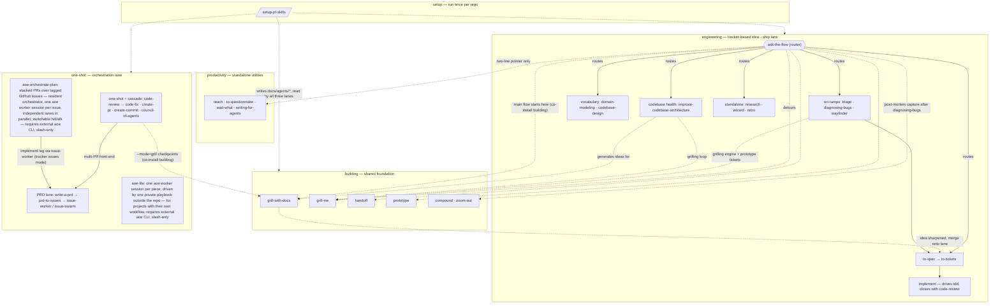

# Catalog map

How the flow-carrying plugins relate. **Solid arrows** are in-plugin flow; **dashed arrows** cross a plugin boundary — every dashed edge is a documented "co-install recommended" dependency, never a hard requirement.

## Reading the shape

- **`building` is pure foundation.** The PRD lane (`write-a-prd` → `prd-to-issues` → `issue-worker`/`issue-swarm`) lives in `one-shot`, whose orchestrator is its only consumer. What remains in `building` — grilling, prototyping, handoff, compound — is shared by both lanes, so co-install it with either.
- **The two idea→ship lanes are partitioned by plugin.** `engineering` (to-spec → to-tickets → implement, tracker-based, slash-driven) and `one-shot` (orchestrated, PRD-file-based) no longer share any lane skill. Pick one lane per project by installing that plugin.
- **`ask-the-flow` only routes; it depends on nothing.** Without `building` installed it still works — it tells you the main flow's first step needs the building plugin, the same way engineering skills say "run `/setup-pf-skills`" when config is missing.
- **Engineering's on-ramps borrow building's grilling engine.** `triage`, `wayfinder`, and `improve-codebase-architecture` invoke `grill-me` (and wayfinder's prototype tickets invoke `prototype`) — the same co-install dependency as the main flow's first step. In the other direction, `ask-the-flow`'s router closes a `/diagnosing-bugs` session by pointing at `compound` for post-mortem capture — that handoff is documented in the router, not in `diagnosing-bugs` itself, so the edge sources from `ask-the-flow`.
- **`aoe-orchestrate-plan` is a second, session-granular pipeline inside `one-shot`.** Where the orchestrator runs one session's cascade, it works a label-tagged GitHub issue group as stacked PRs: a resident orchestrator holds scope/order/mode and a command channel (mode/go/status/stop), turns the issues' dependency graph into a forest of stacks and spawns one aoe worker session + worktree per issue, running independent lanes in parallel up to `--parallel` (each commit gated by an adversarial subagent review); a multi-parent issue gets a single base from a restack worker that rebases its finished parents into one line, and closes with a fresh-context synthesis over all packets that plans follow-up issues and merges + cleans up on the human's yes. It hard-requires the external `aoe` CLI (validated up front, halts without it) and is `disable-model-invocation` — slash-only, since it spawns billed sessions.
- **`productivity` hangs off nothing.** Its one dashed edge is a courtesy pointer, which is why it stays independently installable for non-code projects.
- **Not shown**: `design`, `marketing`, `reviewing` — islands with no edges to any of this.
